<p align="center">
  <b>English</b> · <a href="README.zh-Hans.md">简体中文</a>
</p>

<h1 align="center">Starfold — Xbox streaming for Mac, Apple Vision Pro and Apple TV</h1>

<p align="center">
  Stream your own Xbox console or play Xbox Cloud Gaming in a native, open-source app built with SwiftUI.
</p>

<p align="center">
  <a href="../../releases/latest"><b>Download for Mac</b></a>
  ·
  <a href="#build-from-source"><b>Build from source</b></a>
</p>

<p align="center">
  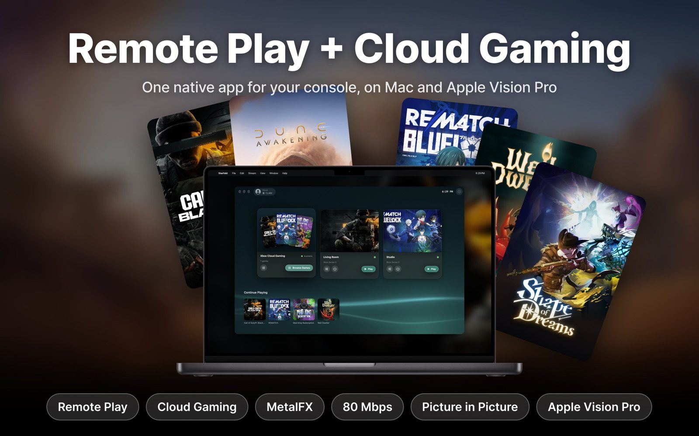
</p>

## What it does

- **Remote Play.** Stream your own Xbox Series X|S or Xbox One over your home network, or from
  anywhere when you're away. Wake and sleep your console, and pick up from the last frame you
  played.
- **Cloud Gaming.** Play Xbox Cloud Gaming titles with no console. Free-to-play games need no
  subscription; other cloud games need your own Game Pass membership.
- **Built for each Apple platform.** Not a web wrapper: a native app for Mac, Apple Vision Pro and
  Apple TV, each in its platform's own idiom.
- **Sharp and responsive.** Up to 80 Mbps, a low-latency mode, MetalFX upscaling and sharpening,
  HDR tone mapping and frame pacing on Mac.
- **Your controller.** Game controllers on every platform, the Siri Remote on Apple TV, and the
  keyboard as a controller on Mac.

## Mac

<table>
  <tr>
    <td>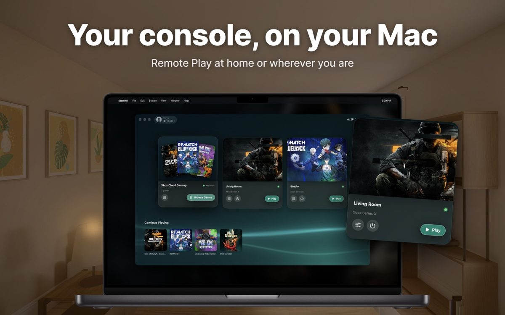</td>
    <td>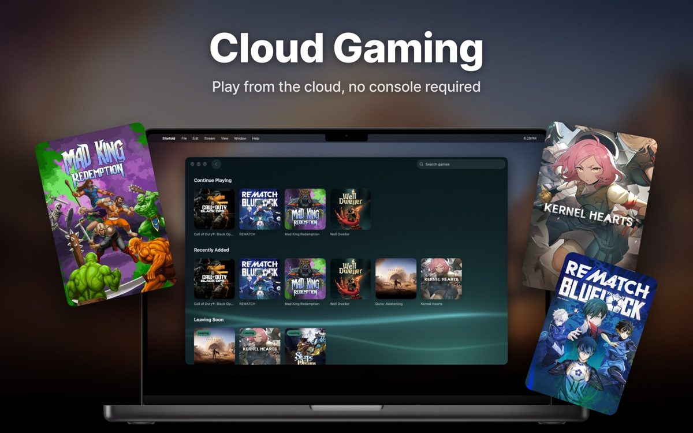</td>
  </tr>
  <tr>
    <td>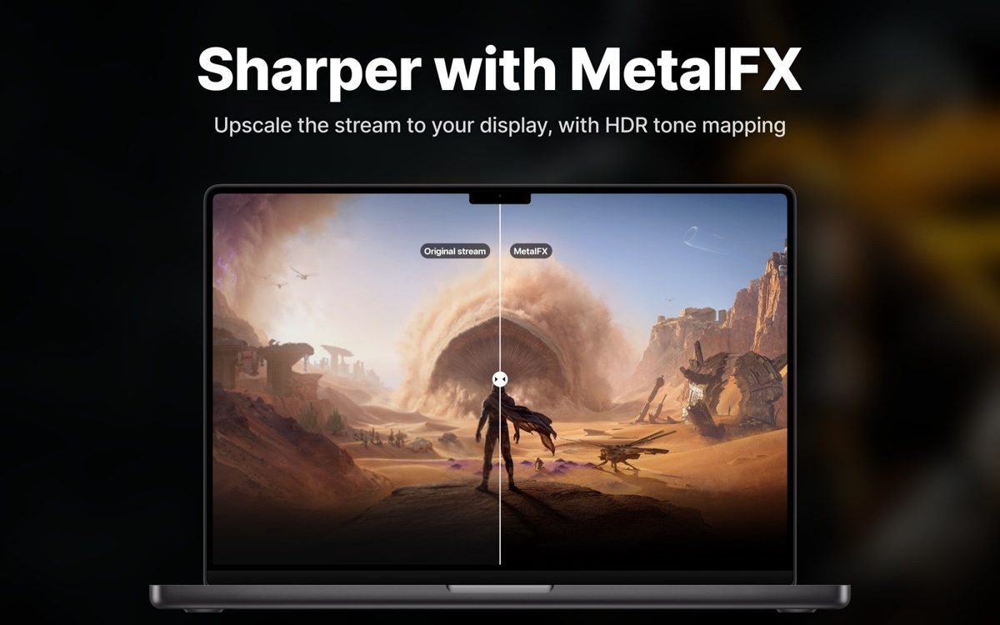</td>
    <td>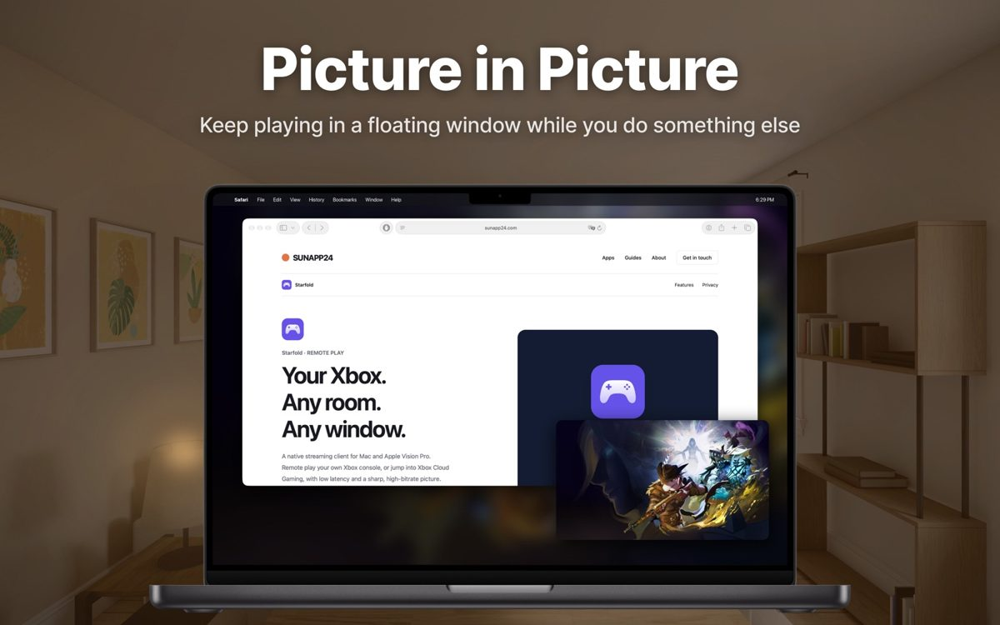</td>
  </tr>
</table>

## Apple Vision Pro

<table>
  <tr>
    <td>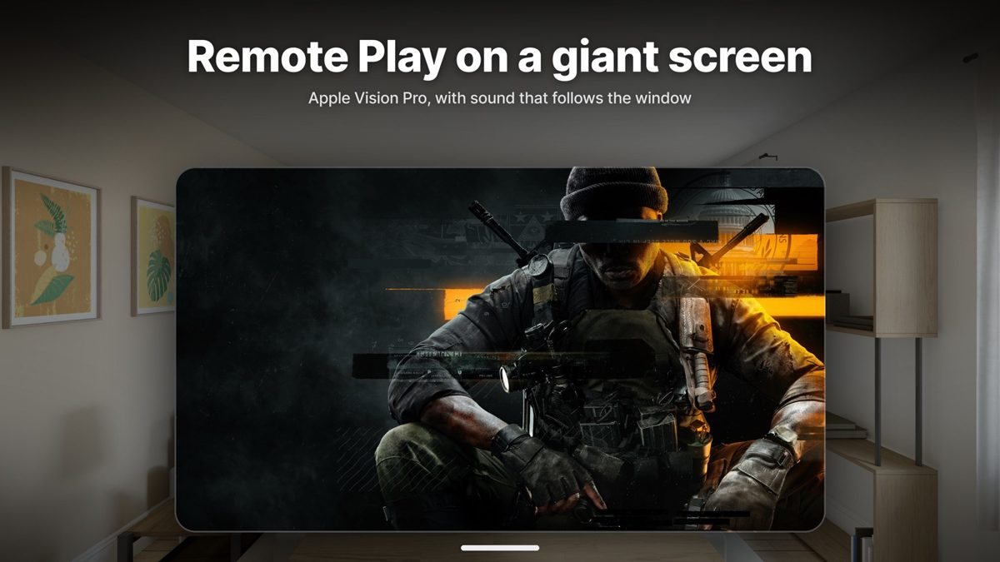</td>
    <td>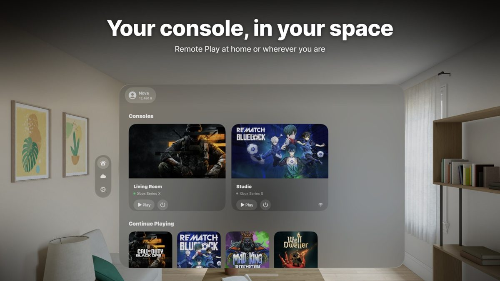</td>
    <td>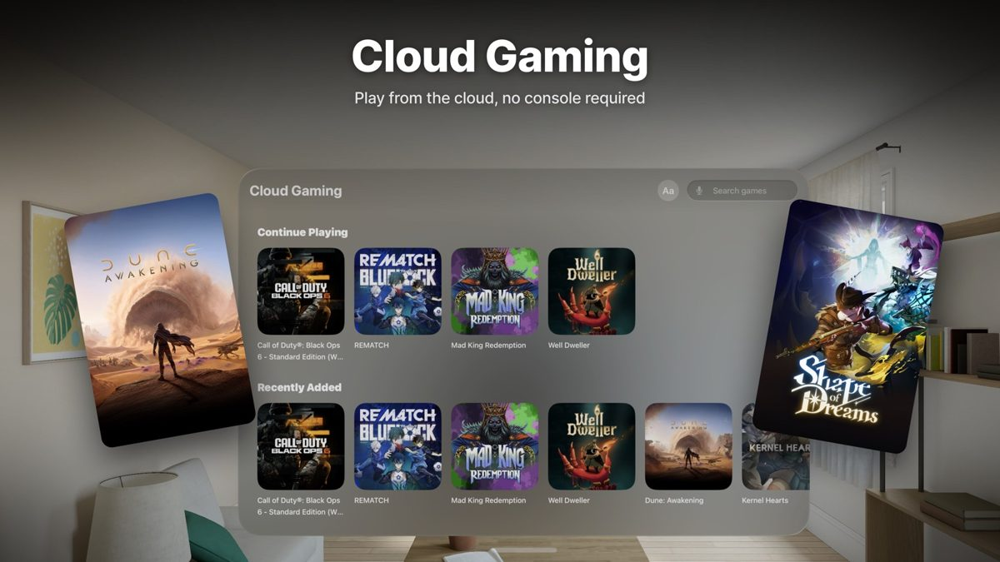</td>
  </tr>
</table>

## Apple TV

<table>
  <tr>
    <td>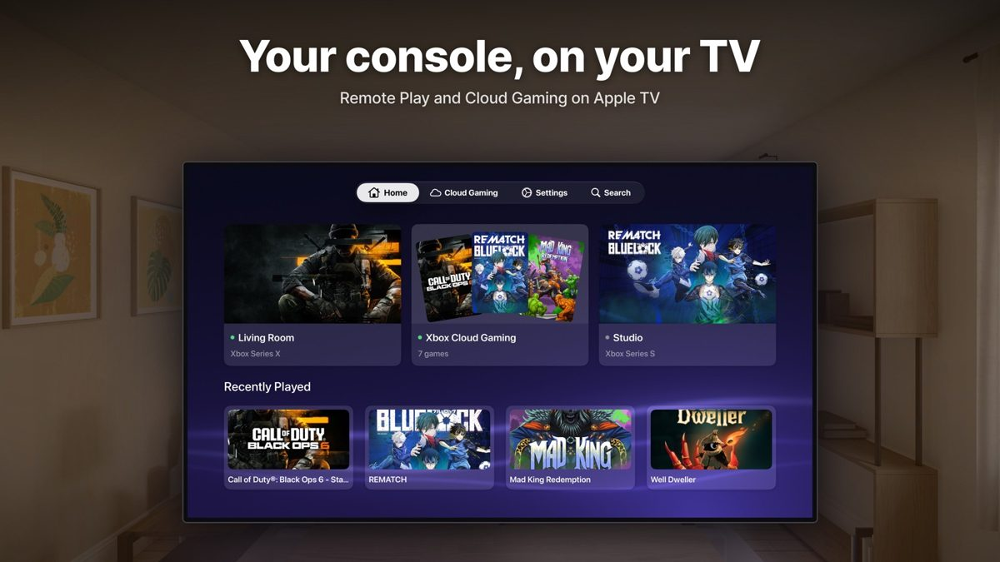</td>
    <td>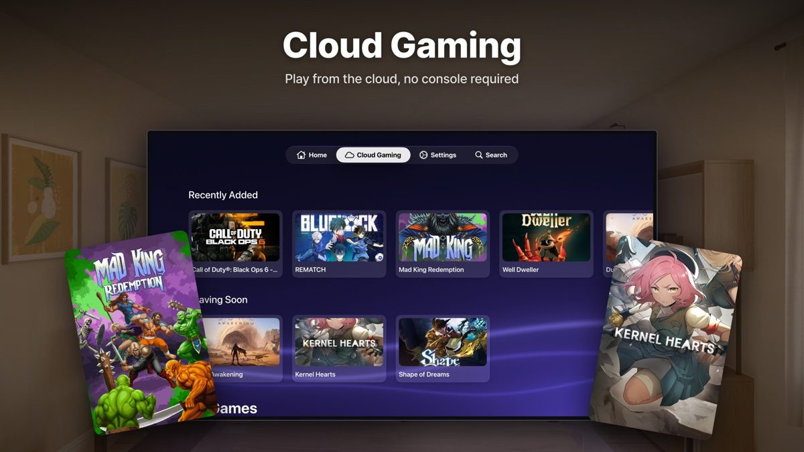</td>
    <td>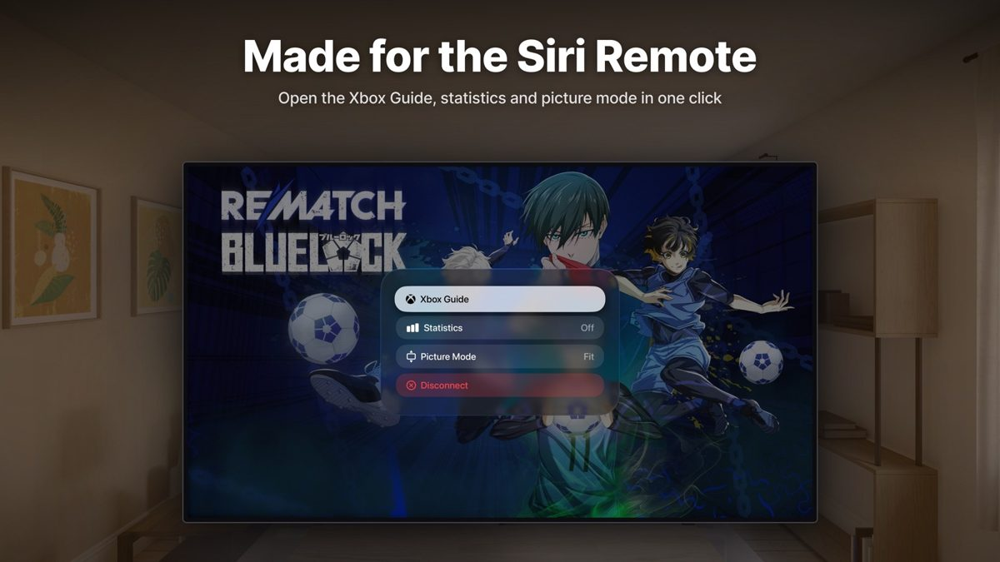</td>
  </tr>
</table>

## Requirements

macOS 26, visionOS 26 or tvOS 26 or later, a Microsoft account and a fast, stable network. Remote
Play also needs an Xbox Series X|S or Xbox One with remote features turned on.

## Build from source

Requires Xcode 27 or later.

1. Clone the repository and open `Starfold.xcodeproj`.
2. Choose the `StarfoldMac`, `StarfoldVision` or `StarfoldTV` scheme.
3. Run. To sign with your own team, create `Configuration/Local.xcconfig` (it stays out of git):

   ```
   STARFOLD_BUNDLE_ID = com.example.starfold
   DEVELOPMENT_TEAM = ABCDE12345
   ```

```sh
scripts/build.sh   # builds all three apps
scripts/test.sh    # runs every package's tests
```

Sign-in uses the public client ID of Microsoft's Xbox web player (`STARFOLD_MICROSOFT_CLIENT_ID`).
Microsoft may restrict it at any time; an ID of your own signs in but may not be allowed to stream.

## Code

Three thin platform apps share one app layer and two protocol packages:

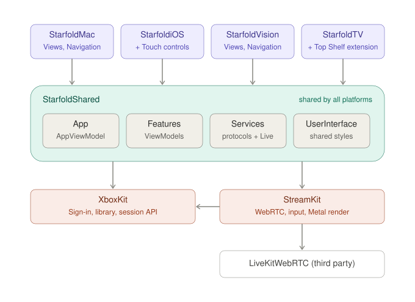

| Module | Responsibility |
|---|---|
| [`StarfoldShared`](Packages/StarfoldShared) | The ViewModels every platform shares, their services and storage, and the shared interface pieces |
| [`XboxKit`](Packages/XboxKit) | Microsoft and Xbox Live sign-in, tokens, consoles, the cloud catalogue and the streaming session API |
| [`StreamKit`](Packages/StreamKit) | One stream: WebRTC, data channels, controller input, rumble, Metal rendering and frame pacing |

Swift 6 with strict concurrency, MVVM with Observation, Swift Testing, English and Simplified
Chinese. How the code is written — architecture, style, views, testing — is described in
[docs/spec](docs/spec/README.md).

## Acknowledgements

Starfold streams with LiveKit's [webrtc-xcframework](https://github.com/livekit/webrtc-xcframework)
(MIT), built from WebRTC (BSD 3-Clause). Full licence texts are in
[THIRD_PARTY_NOTICES.md](THIRD_PARTY_NOTICES.md).

## License

Starfold is released under the [MIT License](LICENSE).

Starfold is an independent app and is not affiliated with, endorsed by, or sponsored by Microsoft
Corporation. Xbox, Xbox Game Pass and Xbox Cloud Gaming are trademarks of Microsoft Corporation,
used for identification only. Game artwork in the screenshots belongs to its publishers.
