

  <a href="README.md">English</a> · <b>简体中文</b>

<h1 align="center">Starfold — 适用于 Apple 平台的 Xbox 游戏串流应用</h1>

  串流你自己的 Xbox 主机，或畅玩 Xbox 云游戏。原生 SwiftUI 应用。

  <a href="../../releases/latest"><b>下载 Mac 版</b></a>
  ·
  <a href="#从源码构建"><b>从源码构建</b></a>

  
  
  
  
  
  
  

  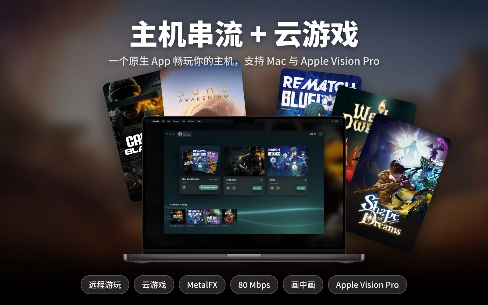

## 功能

- **主机串流**：串流你自己的 Xbox Series X|S 或 Xbox One。
- **云游戏**：不需要主机，直接玩 Xbox 云游戏。
- **多账号**：可登录多个微软账户并随时切换。
- **游戏库**：继续游玩、收藏、搜索和排序。
- **平台**：Mac、iPhone、iPad、Apple Vision Pro 和 Apple TV，均为原生应用。
- **画面**：最高 80 Mbps，支持低延迟模式；Mac 上有 MetalFX 超分和 HDR 色调映射。
- **画中画**：Mac 上可在悬浮窗口中继续游玩。
- **输入**：所有平台都支持手柄；Mac、iPhone 和 iPad 上可以用键盘。
- **触控操作**：iPhone 和 iPad 上使用 Apple 的 [Touch Controller](https://developer.apple.com/documentation/touchcontroller)，支持游戏自带的触控布局，标准布局可以自定义。

## Mac

<table>
  <tr>
    <td>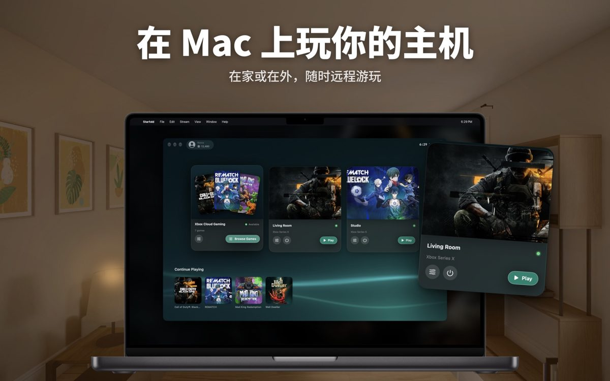</td>
    <td>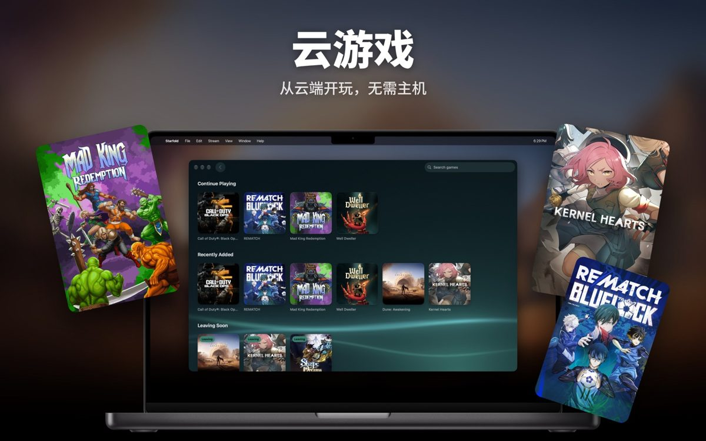</td>
  </tr>
  <tr>
    <td>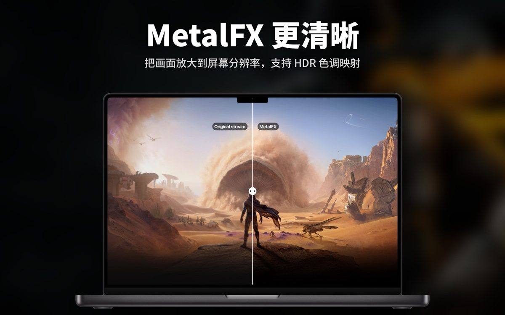</td>
    <td>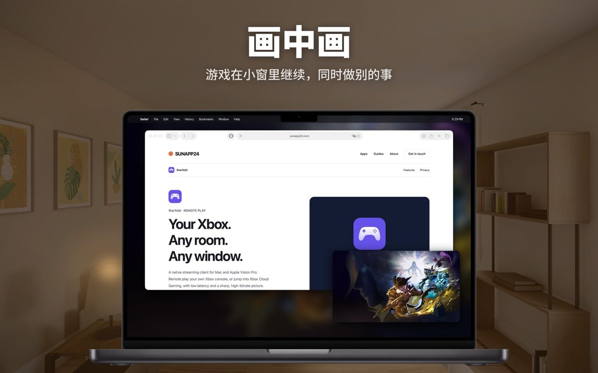</td>
  </tr>
</table>

## iPhone

<table>
  <tr>
    <td width="19.4%">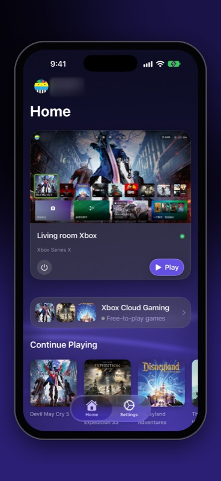</td>
    <td width="80.6%">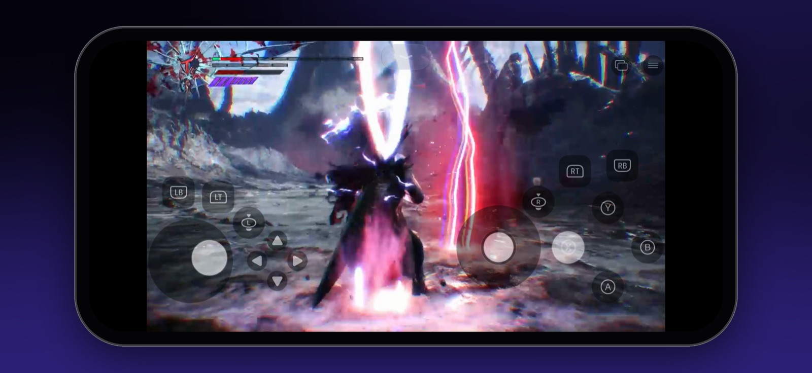</td>
  </tr>
  <tr>
    <td width="80.6%">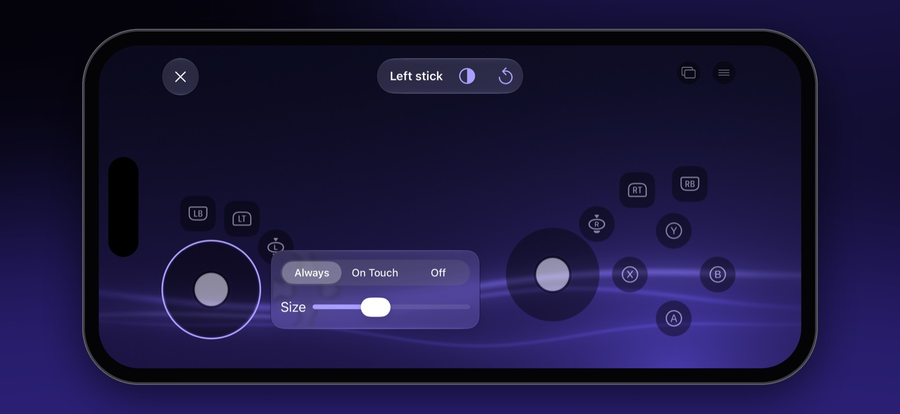</td>
    <td width="19.4%">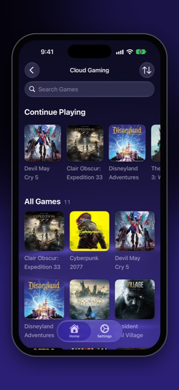</td>
  </tr>
</table>

## iPad

<table>
  <tr>
    <td>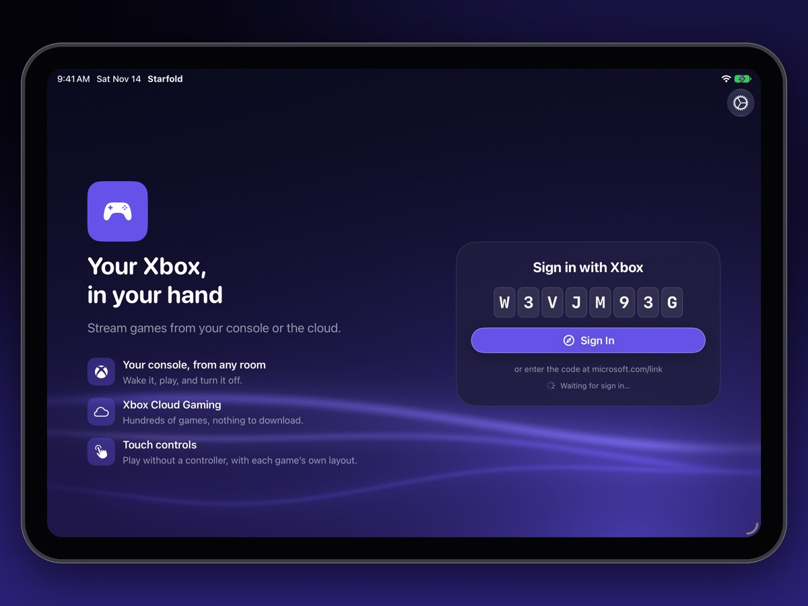</td>
    <td>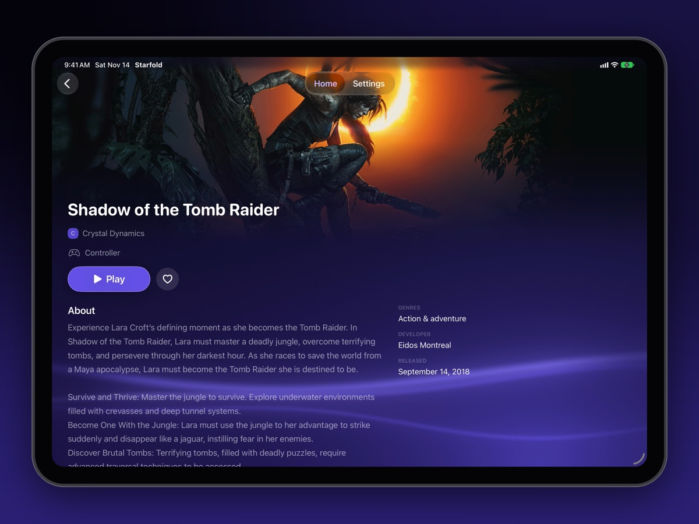</td>
  </tr>
</table>

## Apple Vision Pro

<table>
  <tr>
    <td>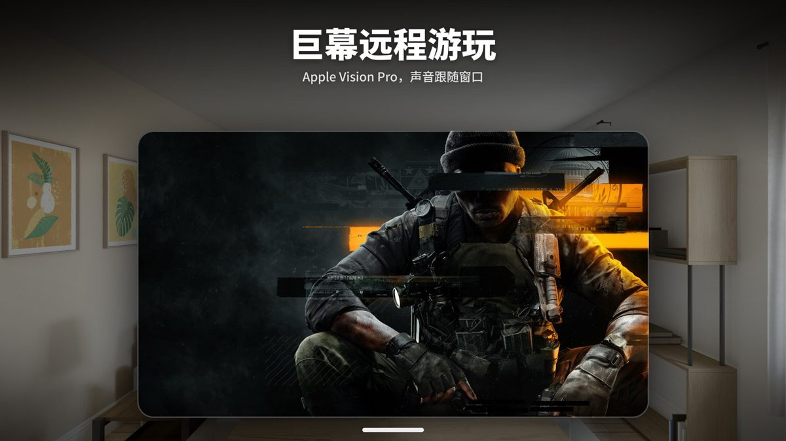</td>
    <td>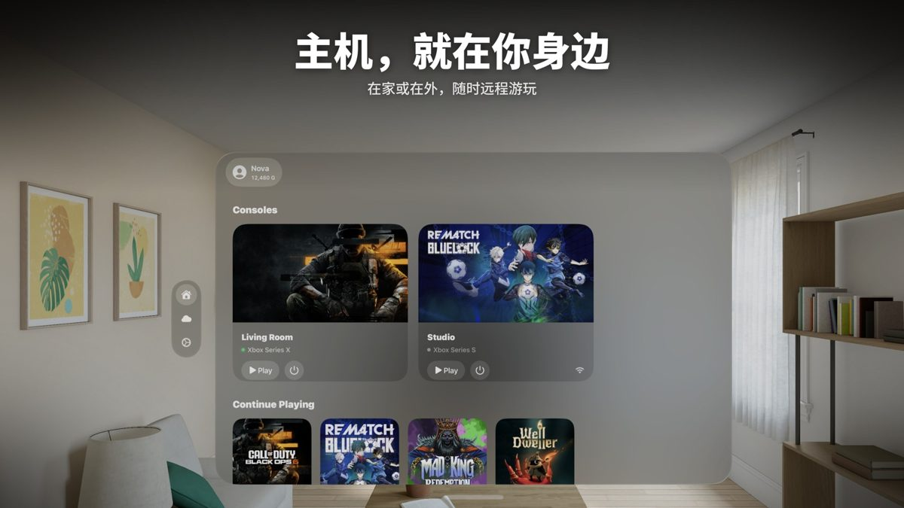</td>
    <td>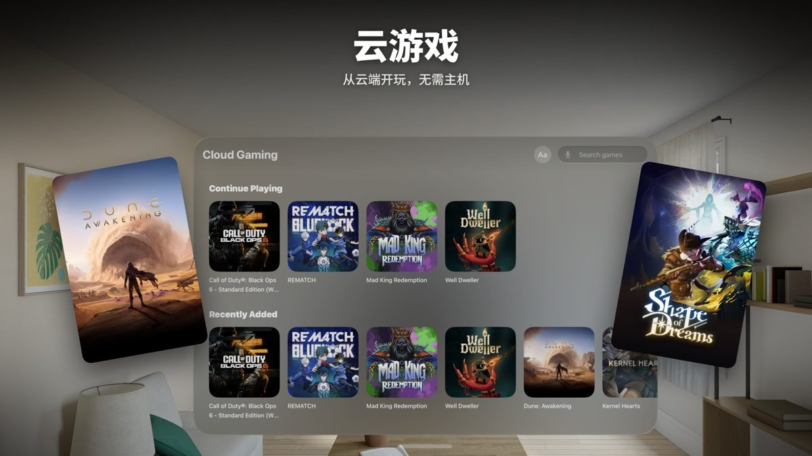</td>
  </tr>
</table>

## Apple TV

<table>
  <tr>
    <td>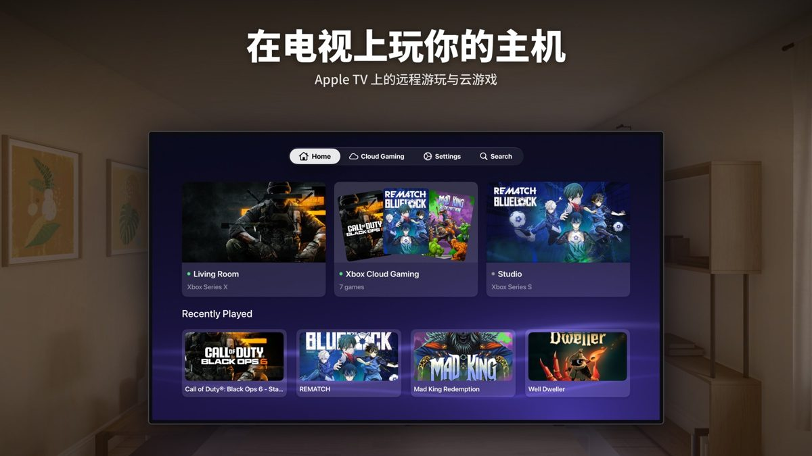</td>
    <td>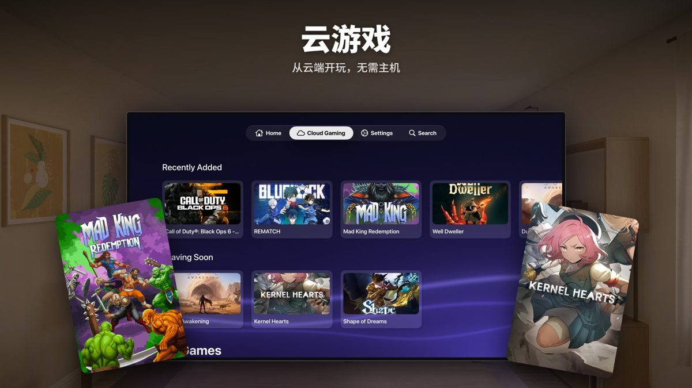</td>
  </tr>
</table>

## 使用要求

macOS 26、iOS 26、iPadOS 26、visionOS 26 或 tvOS 26 及以上版本。

## 从源码构建

需要 Xcode 27 或更新版本。

1. 克隆仓库，打开 `Starfold.xcodeproj`。
2. 选择 `StarfoldMac`、`StarfoldiOS`、`StarfoldVision` 或 `StarfoldTV` scheme。

## 代码

四个很薄的平台应用共用一层应用逻辑和两个协议包：

| 模块 | 职责 |
|---|---|
| [`StarfoldShared`](Packages/StarfoldShared) | 各平台共用的 ViewModel、它们依赖的服务和存储，以及共用的界面组件 |
| [`XboxKit`](Packages/XboxKit) | 微软与 Xbox Live 登录、令牌、主机列表、云游戏目录和串流会话接口 |
| [`StreamKit`](Packages/StreamKit) | 一次串流：WebRTC、数据通道、手柄输入、震动、Metal 渲染与帧节奏 |

Swift 6 严格并发、基于 Observation 的 MVVM、Swift Testing，支持英文和简体中文。代码的架构、风格、视图和测试规范写在 [docs/spec](docs/spec/README.md)（英文）。

## 致谢

Starfold 用 LiveKit 的 [webrtc-xcframework](https://github.com/livekit/webrtc-xcframework)（MIT）串流，它基于 WebRTC（BSD 3-Clause）构建。许可证全文见 [THIRD_PARTY_NOTICES.md](THIRD_PARTY_NOTICES.md)。

## 许可证

Starfold 以 [MIT 许可证](LICENSE) 发布。

Starfold 是一款独立应用，与 Microsoft Corporation 无关联，亦未获其认可或赞助。Xbox、Xbox Game Pass 和 Xbox Cloud Gaming 是 Microsoft Corporation 的商标，此处仅用于识别。截图中的游戏画面版权归各自发行商所有。
