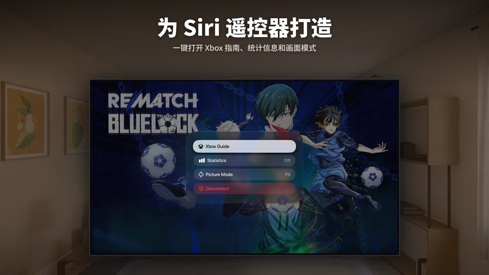

<p align="center">
  <a href="README.md">English</a> · <b>简体中文</b>
</p>

<h1 align="center">Starfold — Mac、Apple Vision Pro 与 Apple TV 上的 Xbox 串流应用</h1>

<p align="center">
  串流你自己的 Xbox 主机，或畅玩 Xbox 云游戏。原生、开源，使用 SwiftUI 打造。
</p>

<p align="center">
  <a href="https://github.com/JarvanSun/Starfold/releases/latest"><b>下载 Mac 版</b></a>
  ·
  <a href="#从源码构建"><b>从源码构建</b></a>
  ·
  <a href="docs/spec/README.md">代码是怎么写的</a>
</p>

<p align="center">
  
  
  
  
  
</p>

<p align="center">
  
</p>

## 功能

- **主机远程游玩**：在家里的局域网中串流你自己的 Xbox Series X|S 或 Xbox One，外出时也能远程连接。可以唤醒、休眠主机，并从上次游玩的画面接着开始。
- **云游戏**：无需主机即可游玩 Xbox Cloud Gaming 游戏。免费游戏无需订阅，其他云游戏需要你自己的 Game Pass 会员。
- **为每个 Apple 平台打造**：不是网页套壳，而是 Mac、Apple Vision Pro 和 Apple TV 上的原生应用，各自遵循平台的设计习惯。
- **清晰、跟手**：最高 80 Mbps 码率、低延迟模式；Mac 上还有 MetalFX 超分与锐化、HDR 色调映射和帧节奏控制。
- **你的手柄**：所有平台都支持游戏手柄，Apple TV 支持 Siri Remote，Mac 上还可以把键盘当手柄用。

## Mac

<table>
  <tr>
    <td></td>
    <td></td>
  </tr>
  <tr>
    <td></td>
    <td></td>
  </tr>
</table>

## Apple Vision Pro

<table>
  <tr>
    <td></td>
    <td></td>
    <td></td>
  </tr>
</table>

## Apple TV

<table>
  <tr>
    <td></td>
    <td></td>
    <td></td>
  </tr>
</table>

## 下载

Mac 版在 [Releases 页面](https://github.com/JarvanSun/Starfold/releases/latest)，已签名并经过 Apple 公证。打开 DMG，把 Starfold 拖到“应用程序”文件夹即可，需要 macOS 26 或更新版本。Apple Vision Pro 与 Apple TV 版需从源码构建。

## 使用要求

需要一个微软账户和快速稳定的网络；远程游玩还需要已开启远程功能的 Xbox Series X|S 或 Xbox One。

## 从源码构建

需要 Xcode 26 或更新版本。

1. 克隆仓库，打开 `Starfold.xcodeproj`。
2. 选择 `StarfoldMac`、`StarfoldVision` 或 `StarfoldTV` scheme。
3. 把 `Configuration/Starfold.xcconfig` 里的 `STARFOLD_BUNDLE_ID` 改成你自己的标识符，在 Signing & Capabilities 中选择你的团队，然后运行。

```sh
scripts/build.sh   # 构建三个应用
scripts/test.sh    # 运行所有包的测试
```

登录用的是微软自家 Xbox 网页版播放器公开的客户端 ID（`STARFOLD_MICROSOFT_CLIENT_ID`），其他开源 Xbox 客户端用的也是它，微软随时可能限制它的使用。目前只确认串流能用这个 ID：换成自己在 Azure 注册的 ID 可以登录，但串流所需的令牌可能会被 Xbox 拒绝。

## 代码

三个很薄的平台应用共用一层应用逻辑和两个协议包：

| 模块 | 职责 |
|---|---|
| [`StarfoldShared`](Packages/StarfoldShared) | 三个平台共用的 ViewModel、它们依赖的服务和存储，以及共用的界面组件 |
| [`XboxKit`](Packages/XboxKit) | 微软与 Xbox Live 登录、令牌、主机列表、云游戏目录和串流会话接口 |
| [`StreamKit`](Packages/StreamKit) | 一次串流：WebRTC、数据通道、手柄输入、震动、Metal 渲染与帧节奏 |

Swift 6 严格并发、基于 Observation 的 MVVM、Swift Testing，支持英文和简体中文。代码的架构、风格、视图和测试规范写在 [docs/spec](docs/spec/README.md)（英文）。

## 致谢

- LiveKit 的 [webrtc-xcframework](https://github.com/livekit/webrtc-xcframework)（MIT），Starfold 串流所用的 WebRTC 构建。

webrtc-xcframework（MIT）与 WebRTC（BSD 3-Clause 及专利授权）的完整许可证文本见 [THIRD_PARTY_NOTICES.md](THIRD_PARTY_NOTICES.md)。

## 许可证

Starfold 以 [MIT 许可证](LICENSE) 发布。

Starfold 是一款独立应用，与 Microsoft Corporation 无关联，亦未获其认可或赞助。Xbox、Xbox Game Pass 和 Xbox Cloud Gaming 是 Microsoft Corporation 的商标，此处仅用于识别。截图中的游戏画面版权归各自发行商所有。

---

作者：Jiawen Sun · [sunapp24.com](https://sunapp24.com)
