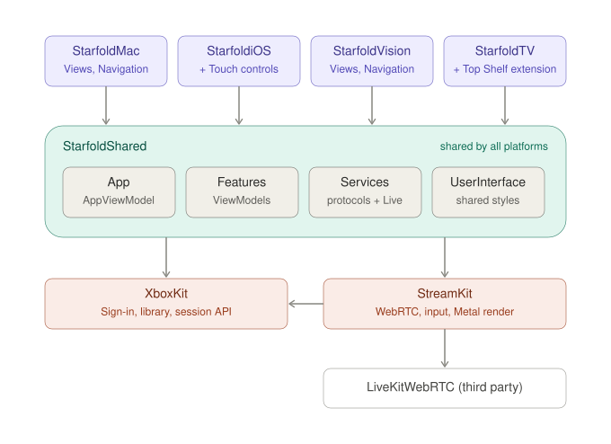

# Architecture

What every platform shares is written once in the packages; what a person sees and touches is
written per platform.

- macOS, visionOS, tvOS and iOS 26 or later. Swift 6, SwiftUI, Observation, MVVM.
- No backend of our own, no analytics, no third-party SDK but WebRTC.

## Modules

| Module | Holds | May import | Never imports |
|---|---|---|---|
| `Starfold<Platform>/` | One app's views, navigation, system bridges | The packages, its platform's frameworks | Another platform's folder |
| StarfoldShared | ViewModels, values, services, storage, shared interface pieces | XboxKit, StreamKit, SwiftUI, frameworks every platform has | AppKit, UIKit, RealityKit, an app |
| StreamKit | WebRTC, data channels, input, rendering, quality | XboxKit, WebRTC, media, Metal, haptics, GameController, UIKit outside macOS | SwiftUI |
| XboxKit | Sign-in, tokens, library, session REST API | Foundation, Security, Synchronization, Compression, os | SwiftUI, WebRTC, StreamKit |
| TopShelfKit / StarfoldTopShelf | The Apple TV Top Shelf snapshot and extension | Foundation / TVServices, TopShelfKit | Everything else |

A dependency not in this table is added to the table first.

- XboxKit and StreamKit know nothing about the apps (no strings, assets or `Preferences`);
  what they need comes through initializers.
- XboxKit owns HTTP and Microsoft's response shapes; StreamKit owns everything after the SDP
  answer ([streaming.md](streaming.md)).
- Each package builds and tests on its own.
- Bundle ID, App Group and Microsoft client ID come from `Configuration/Starfold.xcconfig` through
  Info.plist keys; everything else derives from the bundle ID.

## Platforms

The four app targets share one bundle ID, product name and module name `Starfold`, and link the
three packages.

- Behaviour that differs is passed in by the app (an initializer argument, a closure,
  `StreamPlatform`). App folders never contain `#if os(…)`; StarfoldShared has it only where a
  system API is missing; StreamKit only in the rendering and input types that wrap platform APIs.
- Only `StarfoldiOS/Platform/Touch/` imports Touch Controller.
- Entitlements and Info.plists are in each target's `Configuration/`. iOS declares a launch screen
  and all four iPad orientations, or the upload is rejected. The Mac runpath keeps
  `@executable_path/../Frameworks`, or the installed app quits at launch.

## Isolation

| Module | Default isolation |
|---|---|
| Apps, StarfoldShared, TopShelfKit | `MainActor` |
| XboxKit, StreamKit | Nonisolated; public values are `Sendable` |

- Every module enables `MemberImportVisibility`.
- In `MainActor` modules, write no isolation keyword; `nonisolated` only on the narrowest
  declaration used off the main actor (`StreamConnection`, the Top Shelf values).
- In XboxKit and StreamKit, `@MainActor` only on what the interface calls synchronously
  (`ControllerHub`); network work is `async` on actors; per-frame work on the renderer's queue.
- `@unchecked Sendable` and `nonisolated(unsafe)` only in StreamKit's thread-crossing wrappers,
  each guarding its state with a lock.

## Folders

- An app: its entry point, then `Features/` (one folder per main page; a page reached from one
  sits inside it), `Navigation/`, `Platform/`, `UserInterface/`, `Resources/`,
  `Configuration/`. On tab platforms `Navigation/` holds `RootView` and a `…HostView` per tab.
- A feature has the same name and path in every app (its Views) and in StarfoldShared (its
  ViewModel, `Model/`, `Presentation/`).
- A value used by a service, storage or several features lives in StarfoldShared's top-level
  `Model/`; otherwise in its feature.
- Interface pieces every platform uses live in StarfoldShared's `UserInterface/`, others in the
  app's, in the same subfolders; a view one feature uses lives in its `Components/`.
- XboxKit and StreamKit are grouped by domain (`Auth/`, `Streaming/`, `Input/`, `Rendering/`).
- A folder is named for what it holds; never `Shared/`, `Helpers/`, `Utils/`, `Common/`,
  `Managers/`, `Debug/`. Logic that can be tested on macOS goes to a package.
- No singletons or service locators.
